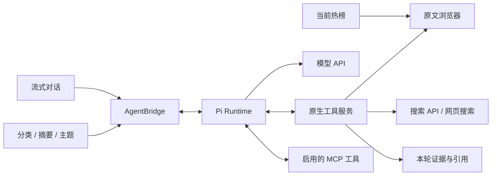

# 架构

TrendingTab 使用一个 Xcode 工程和本地 Swift Package。

| 模块 | 职责 |
|---|---|
| `TrendingTabCore` | 来源、条目、标签、事件、快照和设置模型 |
| `TrendingTabNetworking` | HTTP、并发限制、条件缓存和状态码映射 |
| `TrendingTabSources` | 每个平台的独立请求与解析 |
| `TrendingTabPersistence` | SQLite、迁移、当前榜单缓存、AI 运行和提醒记录 |
| `TrendingTabAggregation` | 标签筛选、排序、事件归并和快照计算 |
| `TrendingTabIntelligence` | Pi 进程桥、任务队列、搜索与证据、Runtime 校验和更新 |
| `TrendingTabNotifications` | 免打扰、频率和跨标签合并 |
| `TrendingTabWidgetBridge` | 原子快照与跨进程标签选择 |
| `TrendingTabKit` | 主应用协调采集、分析和发布 |

## 原文浏览与 AI 研究

`BrowserWorkspace` 在主线程持有 WebView 和标签，用户与 AI 标签共享按稳定标识创建的持久化 `WKWebsiteDataStore`。SwiftUI 仅承载现有 WebView，界面重绘不会重建页面。应用内登录与系统浏览器分别保存；页面标签和对话在关闭窗口或退出后清理。

`BrowserToolBroker` 执行每次浏览器工具请求，检查任务、对话、页面归属、用户授权和导航版本。选中 AI 标签用于预览，网页输入或导航操作会转为用户接管。AI 弹出页面继承任务，用户接管后弹出的页面归用户。同一新闻的追问可以复用已有 AI 页面，但本轮元素引用和用户授权重新建立。

主应用启动专属 Node/Pi 辅助进程，通过四字节长度帧的双向 JSON-RPC 通信。标准输出仅传协议，凭据通过私有管道按需传入；Pi 使用应用专属配置及内存会话。模型连接测试、自动分类、摘要、语义主题和手动对话均通过此桥接，按任务分配连接。界面使用统一的文本、工具、用量与完成事件。

前台与后台任务各允许一个活动任务；AI 页面同时最多加载两个。搜索 API 使用独立匿名会话，登录页面由 WebKit 阅读。证据按对话、任务和材料层级登记，页面内容、搜索摘要及榜单标题分别标注。热点掉榜时解除榜单关联，正在阅读的页面和对话可继续使用。网页脚本后台请求的边界见 [AI 与提醒](ai-and-alerts.md)。

## 独立 Agent Runtime

主应用 DMG 内含 Node、Pi SDK 和桥接脚本作为基线。独立组件以本项目的 Developer ID 签名、公证 DMG 发布；安装器核对 SHA-256、签名身份、票据、架构、系统与应用版本、桥接协议及工具健康检查。组件安装到应用专属版本目录，任务空闲后切换；保留上一版本，启动失败时恢复可用版本。

“设置 → Agent 运行时”显示应用、Runtime、Pi 版本，提供检查、安装和回退。应用每日检查兼容更新，安装由用户启动。组件发布工作流在 Apple Silicon、Intel 运行器分别验证后发布，主应用发布与组件发布使用同一并发组串行执行。

## 热榜与小组件

主应用写入 SQLite，并把配置、标签内容和来源状态生成到 App Group 中的同一代快照。主应用与 Widget 都声明 `group.dev.trendingtab.shared`；Widget Extension 额外启用 sandbox 与网络客户端权限。每个 Widget 使用自己的配置与选择键，因此固定知乎和固定微博的组件不会联动。标签切换只修改对应组件的选择文件并请求 WidgetKit 重载。

`WidgetSelectionScope` 统一生成选择键并解析当前榜单，键包含版本、组件尺寸、显示模式、起始榜单和组件编号。不同尺寸、起始榜单或编号的切换状态分别保存。WidgetKit 提供组件配置，未公开物理组件实例 ID；同尺寸、同起始榜单的多个可切换组件使用不同编号区分，提供 8 个编号。

新组件默认固定显示所选榜单，固定模式始终以组件自身配置为准。已有配置保留显示模式，升级后使用新键按配置初始化。删除或隐藏当前榜单后，依次回退到组件起始榜单、配置默认榜单及首个可用榜单。

榜单采集成功后，用当前结果替换该榜单，掉榜条目及其观察记录随即清理。每条快照内容带独立到期时间，默认采集周期下为 30 分钟；长采集周期使用两倍周期。时间线包含到期后的状态，应用运行时每 30 秒清理过期内容。到期按条目处理，聚合榜中的有效来源继续展示。

主应用和扩展共同编译 `Shared/WidgetIntents.swift`。扩展只链接 Core 与 WidgetBridge，新闻 URL 携带条目、事件及标签身份，由主应用路由到事件中心。发布快照后，主应用请求对应 Widget 时间线刷新。

主应用与扩展共用 `SurfacePalette` 的自适应颜色。事件中心与设置的阅读区、侧栏和卡片使用相近的明度层次；小组件使用低饱和度渐变与边缘高光，增加对比度时简化背景光晕。

条目身份优先使用平台原生 ID，否则使用去除跟踪参数后的 URL 哈希。平台标签保留原排名；跨平台标签使用排名融合和时效，不直接相加热度原值。
